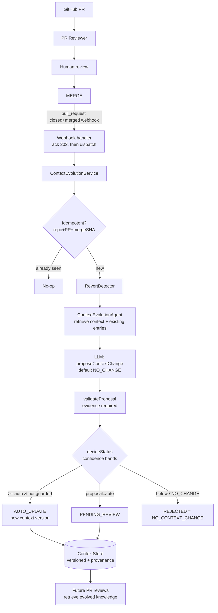

# Revisor — AI Business-Aware Pull Request Reviewer

Revisor reviews GitHub Pull Requests using **both** technical code analysis and
**business-domain context**. Its differentiator is catching code that is
*technically valid* but violates a **business rule, domain invariant,
architectural decision, or previously established behavior** — the kind of thing
a generic "LLM reads the diff" reviewer misses.

The **primary model runs locally**: Qwen3-Coder via an OpenAI-compatible server
(Ollama by default), so reviews need no cloud API and no per-token spend. Claude
is available as an alternative provider.

```
GitHub PR ──webhook──▶ Review Service
                         ├─ fetch PR metadata + diff + changed files
                         ├─ identify changed concepts (query build)
                         ├─ retrieve business context  (docs/ai)
                         ├─ retrieve technical/architecture context
                         ├─ analyze  (LLM pass 1)
                         ├─ validate (LLM pass 2, adversarial)
                         ├─ policy filter (deterministic, in code)
                         └─ post review + inline comments ──▶ GitHub
```

## Why this design

The core product is **business-aware software-engineering review**, so the
architecture is built around one idea: *business rules, ADRs, domain docs, and
repository history are first-class review inputs*, retrieved and injected as
structured, clearly-delimited context — never an uncontrolled repo dump.

Two principles shape everything:

1. **Never trust the first LLM response.** Analysis and validation are separate
   passes, and a deterministic policy filter (in `domain/policy.ts`) runs on top
   — so unsupported or low-confidence findings are dropped in *code*, not left to
   model discretion.
2. **Repository content is untrusted data, not instructions.** Diffs, code, PR
   descriptions, and even the docs are sanitized and wrapped as inert data to
   resist prompt injection; the review policy lives only in the system prompt.

## Architecture

Clean / hexagonal layering — the domain is pure and every external dependency
sits behind an interface with a real **and** a fake implementation:

```
src/
  domain/          Pure types + Zod schemas + pure policy logic (no I/O).
    review, context, policy · context-evolution, context-store, context-policy
  application/     Orchestration + composition helpers.
    review-pipeline, providers · context-evolution-agent, context-evolution-service
  context/         ContextProvider → DocumentContextProvider (docs) + ContextStoreProvider
                   (evolved knowledge) + Composite (both, for reviews).
  integrations/
    github/        GitHubClient → Octokit | Fixture · RevertDetector (heuristic).
    llm/           LLMProvider → Qwen (primary) | Claude | Heuristic | Stub.
                   generateReview · validateFindings · proposeContextChange.
    history/       HistoryProvider → Null (MVP), ready for git log/blame/PRs.
  prompts/         Composable prompts + sanitization; review & context-evolution.
  review/          Presentation: ReviewResult → GitHub markdown + inline comments.
  infrastructure/  config (Zod env), logging (correlation ids), http (Fastify webhook),
                   context-store/ (FileContextStore — the ContextStore impl).
  cli/             Offline runners: review + context:review.
docs/ai/           Human-authored business/architecture/domain knowledge base.
fixtures/          Review fixtures + fixtures/context/ (merge/revert/technical/ambiguous).
tests/             Unit + integration tests (Vitest, 120 tests).
```

### Interfaces that keep the future open

| Interface          | MVP implementation        | Swappable for (no pipeline rewrite)              |
| ------------------ | ------------------------- | ------------------------------------------------ |
| `ContextProvider`  | `DocumentContextProvider` | pgvector, Qdrant, Pinecone, hybrid semantic+BM25 |
| `ContextStore`     | `FileContextStore` (JSON) | PostgreSQL, pgvector, Qdrant, graph DB           |
| `LLMProvider`      | `QwenLocalLLMProvider` (primary), `ClaudeLLMProvider`, `HeuristicLLMProvider` | any model vendor; multi-agent reviewers |
| `GitHubClient`     | `OctokitGitHubClient`     | GitHub App, GitHub Actions runner                |
| `RevertDetector`   | `HeuristicRevertDetector` | git-graph / patch-similarity analysis            |
| `HistoryProvider`  | `NullHistoryProvider`     | git log/blame, prior PRs, incident knowledge     |

The webhook handler marks the exact seam where a **job queue** would go (it acks
`202` immediately, then reviews / evolves context). Nothing assumes in-process
execution. See **[Context Evolution](#context-evolution-learning-from-merged--reverted-prs)**
for how merged PRs teach the reviewer.

## The review finding model

Findings are structured and evidence-first (`domain/review.ts`):

```ts
interface ReviewFinding {
  category: 'business' | 'technical';
  severity: 'BLOCKER' | 'IMPORTANT' | 'SUGGESTION';
  certainty: 'confirmed' | 'likely' | 'potential' | 'insufficient-evidence';
  confidence: number;                 // 0..1
  title; problem; impact; recommendation;
  file?; line?;
  evidence: { source: string; detail: string }[];   // business findings REQUIRE this
  businessRule?: string;
}
```

**Confidence rules (enforced in `domain/policy.ts`):**

- Findings below `REVIEW_MIN_CONFIDENCE` are dropped.
- Business findings with no evidence are dropped.
- A `BLOCKER`/`IMPORTANT` below `REVIEW_BLOCKING_CONFIDENCE` is downgraded to a
  non-blocking `SUGGESTION`.
- Only a confident `BLOCKER` yields `request_changes` (never in dry-run).
- Findings are capped so developers aren't overwhelmed.

## Getting started

```bash
npm install
cp .env.example .env
```

### Run the local model (primary)

The default provider is **Qwen3-Coder**, served locally through an
OpenAI-compatible endpoint. With [Ollama](https://ollama.com):

```bash
OLLAMA_CONTEXT_LENGTH=16384 ollama serve
```

```bash
ollama pull qwen3-coder        # or qwen2.5-coder:14b / :7b (lighter, fit <=18GB RAM)
```

`QWEN_BASE_URL` defaults to `http://127.0.0.1:11434/v1` and `QWEN_MODEL` to
`qwen3-coder`. Other OpenAI-compatible servers work by changing `QWEN_BASE_URL`
(vLLM `:8000`, llama.cpp `:8080`, LM Studio `:1234`).

> **⚠️ Required: give the server a real context window.** A review prompt is
> ~5–8K tokens (system prompt + diff + retrieved business context), but Ollama's
> **default context is only ~2–4K tokens** — it silently truncates the prompt
> from the front, **dropping the diff**, so the model "reviews" only the trailing
> context docs (hallucinated summaries, missed findings). Start Ollama with
> `OLLAMA_CONTEXT_LENGTH=16384` (put it in your shell profile / launch agent so
> it survives restarts). **Symptom of too-small context:** the review describes
> files that aren't in the diff. Also use `127.0.0.1`, **not** `localhost` —
> Node 18's `fetch` prefers IPv6 `::1` but Ollama binds IPv4 only.

Switch providers with `LLM_PROVIDER`:

| `LLM_PROVIDER` | Reviewer |
| -------------- | -------- |
| `qwen` (default) | Local Qwen3-Coder (OpenAI-compatible) |
| `claude`         | Anthropic Claude (needs `ANTHROPIC_API_KEY`) |
| `heuristic`      | Offline rule-based, no model / no network |

### Review a PR offline (no GitHub, no spend)

This is the primary iteration loop — run the full pipeline against a fixture:

```bash
npm run review -- ./fixtures/02-business-rule-violation.json
npm run review -- ./fixtures/02-business-rule-violation.json --json
```

- Default (`LLM_PROVIDER=qwen`) → a real local Qwen3-Coder review (needs the
  server running).
- `LLM_PROVIDER=heuristic` → an offline rule-based reviewer (no model) so the
  pipeline still runs end-to-end with zero dependencies.

### Run the webhook server

```bash
npm run dev          # tsx watch
# or
npm run build && npm start
```

- `GET /health` — readiness + which providers are wired.
- `POST /webhook/github` — verifies the `X-Hub-Signature-256` HMAC, validates the
  payload, enforces the repo allowlist, then reviews `pull_request` events
  (`opened`, `reopened`, `synchronize`, `ready_for_review`).

Point a GitHub webhook (content-type `application/json`, secret =
`GITHUB_WEBHOOK_SECRET`) at `/webhook/github`. With `GITHUB_TOKEN` set and
`REVIEW_DRY_RUN=false`, Revisor posts a review with inline comments.

### Scripts

| Command             | Purpose                                  |
| ------------------- | ---------------------------------------- |
| `npm run dev`       | Run the webhook server (watch mode)      |
| `npm run review`    | Offline review of a fixture              |
| `npm run context:review` | Offline context evolution on a merged/reverted PR fixture |
| `npm test`          | Run the test suite (Vitest)              |
| `npm run typecheck` | `tsc --noEmit`                           |
| `npm run lint`      | ESLint                                   |
| `npm run build`     | Compile to `dist/`                       |

## Business context (`docs/ai`)

Everything the reviewer treats as ground truth lives here. Document business
rules, domain entities, invariants, state transitions, financial rules,
integration contracts, architectural constraints, edge cases, and historical
incidents. The reviewer cites these files by path as evidence and **must not**
assert a business rule that isn't documented. See
[`docs/ai/README.md`](docs/ai/README.md).

## Context Evolution (learning from merged & reverted PRs)

`docs/ai` is human-authored ground truth. **Context Evolution** is the system
*learning on its own*: when a PR is **merged** (or **reverted**), an agent
decides whether the change introduced durable knowledge future reviewers should
know, and persists it as versioned, provenance-carrying context that later
reviews retrieve.

**It optimizes for precision, not growth.** Most merges (typos, formatting,
dependency bumps, behavior-preserving refactors, test/logging changes) produce
`NO_CONTEXT_CHANGE`. Only meaningful changes to business rules, invariants, state
transitions, integration/financial/authorization behavior, architectural
decisions, or newly-discovered edge cases become context.



### Lifecycle & components (all behind interfaces)

| Concern | Component | Note |
| --- | --- | --- |
| Detect + dispatch | webhook handler | Acks `202` first; **never** runs analysis inline. |
| Decide | `ContextEvolutionAgent` | Retrieves context, calls the LLM, reconciles reverts. |
| Orchestrate | `ContextEvolutionService` | Idempotency, thresholds, persistence, approval hooks. |
| Detect reverts | `RevertDetector` | Multi-signal; never fabricates the original PR. |
| Persist | `ContextStore` (`FileContextStore`) | Versioned JSON; **RAG-swappable** (see below). |
| Propose | `LLMProvider.proposeContextChange` | Same provider seam as the reviewer (Qwen/Claude). |

### Merge detection

A merged PR is the GitHub `pull_request` webhook with `action = "closed"` and
`pull_request.merged = true`. The handler acknowledges immediately, then fetches
the PR (diff, commits, merge SHA) and runs analysis asynchronously — so slow LLM
work can never make GitHub time out and retry.

### Revert detection

GitHub has no semantic "reverted" event, so `HeuristicRevertDetector` combines
signals (never title alone): the `revert-<N>-…` branch name, `This reverts commit
<sha>` in commits, `reverts #N` references, and the `Revert "…"` convention. It
returns a confidence + evidence and **only names an original PR when it found
one**. Ambiguous mentions of "revert" are not treated as reverts.

### Revert semantics — never destroy history

A revert **deactivates** current knowledge while **preserving** provenance. If
PR #421 introduced a rule and PR #450 reverts it, the store keeps `v1 [REVERTED]`
(from #421) and adds `v2 [ACTIVE] REVERT` (from #450) stating the now-current
behavior. `getCurrent(topic)` reflects the revert; `getHistory(topic)` answers
*what did we believe, when, and why*.

### Context versioning & provenance

Every entry carries `version`, `status` (`ACTIVE`/`SUPERSEDED`/`DEPRECATED`/
`REVERTED`), `changeType`, `confidence`, `evidence`, `source` (PR + merge SHA),
`previousVersion`, and `createdAt`. The system can always answer **what it
currently believes** and **why**.

### Confidence thresholds & human approval

`confidence ≥ CONTEXT_AUTO_UPDATE_THRESHOLD` → applied automatically
(`AUTO_UPDATE`); `[proposal, auto)` → `PENDING_REVIEW` (recorded, current context
unchanged); `< CONTEXT_PROPOSAL_THRESHOLD` → `NO_CONTEXT_CHANGE`. Set
`CONTEXT_REVIEW_REQUIRED_CATEGORIES` (e.g. `BUSINESS_RULE,SECURITY`) to force
high-impact categories to `PENDING_REVIEW` regardless of confidence.
`service.approveProposal(id)` / `rejectProposal(id)` action the queue.

### Idempotency & failure isolation

Redelivered webhooks are no-ops (idempotency key = repo + PR + merge SHA +
event). Context-evolution failures never fail the merge — the webhook acks
first, and analysis errors default to `NO_CONTEXT_CHANGE`. The in-process
dispatch is the marked seam for a job queue.

### Security

Repository content (PR body, code, commits, docs) is **untrusted evidence, never
instructions**. The prompt establishes an explicit hierarchy — *system policy >
evolution instructions > repository content* — and all such content is sanitized
(injection attempts flagged, secrets redacted) via the same layer as the
reviewer. Provenance (`sourcePullRequest`) is filled from the real PR, so the
model can't fabricate it. Secrets/tokens are never logged.

### Local testing

Run the whole flow offline against fixtures — no GitHub:

```bash
npm run context:review -- ./fixtures/context/merged-pr.json        # business change
npm run context:review -- ./fixtures/context/technical-only-pr.json # NO_CONTEXT_CHANGE
npm run context:review -- ./fixtures/context/reverted-pr.json       # revert semantics
npm run context:review -- ./fixtures/context/ambiguous-revert.json  # not a revert
```

Each runs in an ephemeral store (seeded from the fixture) and prints the
decision, proposal, evidence, current context, and full history. Add `--json`
for machine-readable output.

### Future RAG integration

`ContextStore` and `ContextProvider` are storage-agnostic interfaces — entries
are structured records, **not** Markdown. Replacing `FileContextStore` with
PostgreSQL, **pgvector**, Qdrant, or a graph DB is a drop-in change: the agent,
service, thresholds, revert logic, and reviewer are untouched. The retrieval
side already composes the docs provider with the evolving store
(`CompositeContextProvider`), so a vector-ranked store slots straight in.

## Security

- Webhook HMAC signature verification (constant-time); payloads are schema-validated.
- Least-privilege GitHub token (PRs read/write, contents read).
- Secrets are validated at startup, redacted in logs, and never placed in prompts.
- Repository content (code, comments, PR descriptions, docs) is sanitized and
  treated as untrusted data — prompt-injection attempts are neutralized and flagged.
- Bounded context: only relevant, size-capped content is sent to the LLM.

## Observability

Structured `pino` logs, one **correlation id** per review, covering:
`review_started`, `context_retrieved`, `llm_request_started/completed`,
`validation_started/completed`, `finding_generated`, `finding_rejected`,
`review_completed`, `github_comment_created`, `review_failed`.

## Testing

`npm test` runs 120 unit + integration tests. **Reviewer:** policy filtering,
confidence bands, validation merge, context retrieval, prompt construction (incl.
injection handling), formatting, signature verification, the GitHub and LLM
adapters (with fakes), and the full pipeline over the 5 review fixtures (with a
**no-false-positives** guard on the clean PR). **Context Evolution:** threshold
decisions, evidence-required validation, versioning/provenance, revert detection
(standard / reference / commit-message / ambiguous), revert semantics
(deactivate + preserve history), idempotency, LLM-failure and invalid-output
handling, the human-approval hooks, prompt-injection safety, and the store-backed
retrieval provider — plus the four `fixtures/context/` scenarios end-to-end.

## Would this scale to 1,000 repos / millions of LOC?

The seams are already there: retrieval is an interface (swap docs → vector DB per
repo/tenant), the LLM is an interface (swap in multi-agent reviewers), the
webhook acks-then-processes (drop in a queue), and findings are structured data
(store them, track accepted/rejected, learn over time). What the MVP deliberately
does *not* do — vector DB, queue, multi-agent, persistence — can be added behind
these interfaces without reshaping the pipeline.

## Roadmap (designed-for, not built)

RAG/vector retrieval · multi-agent reviewers · GitHub App / Action · job queue ·
review-history persistence · accepted/rejected finding tracking & learning ·
code/dependency graph · incident & ticket integration · Slack notifications.
